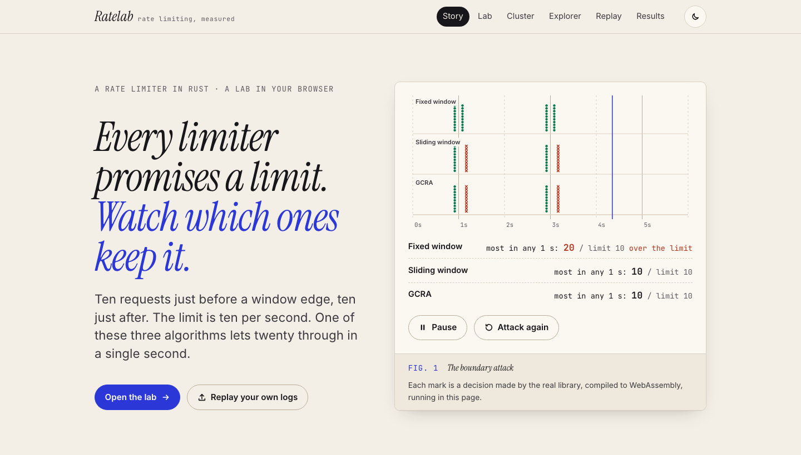
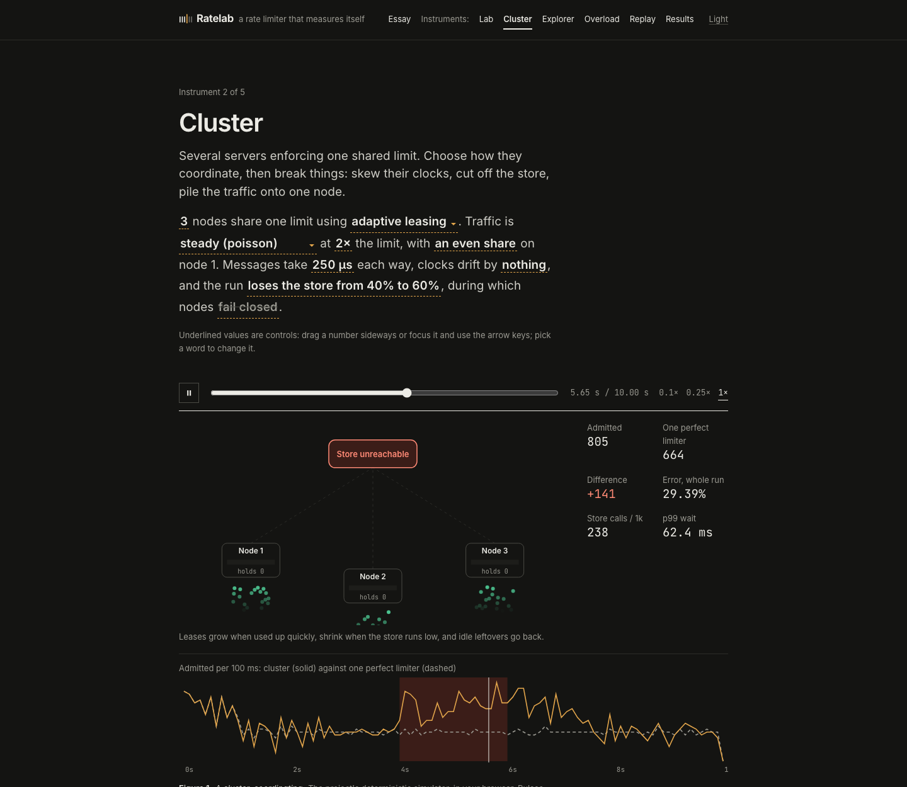

# Distributed Rate Limiter

<div align="center">

[](https://github.com/azzs11/distributed-rate-limiter/actions/workflows/rust.yml)


**Rate limiting algorithms in Rust (token bucket, leaky bucket, fixed and sliding window, GCRA), shared across nodes through Redis, with a benchmark that reproduces every number below.**

**[Open the playground](https://azzs11.github.io/distributed-rate-limiter/)**: the real library, compiled to WebAssembly, running in your browser.

[Playground](#playground) • [Features](#features) • [Quick Start](#quick-start) • [Benchmarks](#benchmarks) • [Roadmap](#roadmap)

</div>

---

## Overview

Five rate limiting algorithms behind one `RateLimiter` trait, with thread-safe
state and injected time; a Redis store that several nodes share, behind a circuit
breaker; an Axum server whose Tower layer sends IETF `RateLimit` headers; five
**coordination strategies** for enforcing one limit across N nodes, compared in a
deterministic cluster simulator; an adaptive **concurrency limit** (AIMD and
Gradient2) that sheds overload before it turns into timeouts; and a benchmark that
measures accuracy against an exact oracle, on one machine and on a 3-node Docker
cluster.

The project is being reworked into a rate limiter that **measures and reports
its own accuracy**. See [docs/ROADMAP.md](docs/ROADMAP.md) for the plan.

---

## Features

### Algorithms (in-process, `drl-core`)

| Algorithm | How it works | Trade-off |
|-----------|--------------|-----------|
| **Token Bucket** | Tokens refill at a constant rate; each request spends its cost | Allows bursts up to the bucket size |
| **Leaky Bucket** | Requests fill a bucket that drains at a constant rate | Smooths bursts; bursty traffic gets rejected |
| **Fixed Window** | Counts usage per fixed time window | Simplest; can admit a burst above the limit around a window boundary |
| **Sliding Window** | Stores each admitted request in the window | Exact limit, but memory grows with the limit |
| **GCRA** | Tracks one theoretical arrival time per key | Same decisions as the token bucket, one number of state per key |

How they behave:

- **One API:** `check(&self, key, cost)` returns a `Decision` with `allowed`,
  `remaining`, `reset_after` and `retry_after`.
- **Thread-safe:** limiters take `&self` and keep per-key state in a `DashMap`, so one
  instance can be shared across threads. State is **not** shared between processes.
- **Injected time:** algorithms read time from a `Clock`. Tests use `ManualClock`
  and never sleep.
- **Exact integer arithmetic:** the same inputs give the same decisions on every
  platform, including WebAssembly.
- **Shared conformance suite:** every algorithm must pass the same tests
  (`crates/core/tests/conformance.rs`), including an exact `retry_after` and a
  multi-threaded no-over-admission check.

### Shared through Redis (`drl-redis-store`)

`RedisRateLimiter` keeps a token bucket per key in Redis, so every node that talks
to the same Redis enforces one shared limit.

- **One multiplexed connection** per limiter, reconnecting automatically.
- **EVALSHA:** the Lua script ([`scripts/token_bucket.lua`](crates/redis-store/scripts/token_bucket.lua))
  is sent by hash; the full script only goes over the wire again after `NOSCRIPT`.
- **Redis `TIME`:** the script reads Redis's clock, not the application server's,
  so nodes with skewed clocks still agree.
- **Exact integers:** token amounts are scaled by the window in microseconds and
  kept below 2^53, so Lua's doubles never round.
- **Circuit breaker:** `GuardedLimiter` wraps the store in a closed / open /
  half-open breaker (`drl_core::CircuitBreaker`). While Redis is down, each
  call's `FailurePolicy` decides: **fail open** (allow) or **fail closed** (deny).
- **Tested against a real Redis** started by testcontainers, including an outage.

### Coordination strategies (`drl_core::strategies`)

How N nodes enforce **one** limit together. Each strategy is a state machine with no
I/O: it receives requests, store replies and timer ticks, and returns decisions and
messages for a shared store (the logic Redis runs). The same code runs in the
simulator, in tests, and on the real cluster: `web-server --backend strategy
--strategy adaptive_leasing` runs a node against Redis through `scripts/store_op.lua`.

| Strategy | Talks to the store | Trade-off |
|----------|--------------------|-----------|
| `central_exact` | once per request | exact; every request waits a round trip |
| `local_split` | never | each node gets `limit / N`; wrong when traffic is uneven |
| `async_sync` | one sync per key every few ms | never waits; over-admits between syncs |
| `fixed_leasing` | once per fixed chunk of tokens | spends borrowed tokens locally; leftovers expire |
| `adaptive_leasing` | leases sized by demand | lease grows when used up fast, shrinks when the store is short, idle leftovers go back |

The simulator (`sim::cluster`) runs N nodes and a store over a simulated network with
delay, jitter, clock skew, timeouts and outages, from one event queue and a seed, so
every run is reproducible bit for bit. Every strategy passes a shared conformance
suite (`crates/sim/tests/strategy_conformance.rs`).

### HTTP server (`crates/server`)

An Axum app with a Tower `RateLimitLayer` on real routes:

| Route | Policy | When Redis is down |
|-------|--------|--------------------|
| `GET /api/hello` | `public` | fails open |
| `POST /api/orders` | `orders` | fails closed |
| `GET /health`, `GET /metrics` | not limited | |

Every limited response carries the IETF draft headers
([draft-ietf-httpapi-ratelimit-headers](https://datatracker.ietf.org/doc/draft-ietf-httpapi-ratelimit-headers/)):

```text
RateLimit-Policy: "public";q=100;w=1
RateLimit: "public";r=99;t=1
Retry-After: 1                       (on 429 only)
x-drl-source: redis                  (local | redis | breaker_open | redis_error)
```

Callers are identified by the `x-api-key` header, else their IP. Time values are
rounded **up** to whole seconds, so a client that waits `Retry-After` never retries
too early. `/metrics` exports Prometheus counters and a decision-time histogram
(through the `metrics` crate).

#### Overload protection

A rate limit caps requests per window, but it cannot see a backend slow down: it keeps
admitting the same rate, queues grow past the clients' deadlines, and the backend
spends its time on answers nobody waits for. `ConcurrencyLimitLayer` caps requests
**in flight** instead and answers `503` at once above the limit. The limit can be
static or adapt to what each finished request reports:

- **AIMD:** +1 while the limit is in use, ×0.9 on a timeout or `5xx`;
- **Gradient2:** shrinks when recent latency rises above 1.5× its long-term average.

```bash
cargo run -p server --bin web-server -- --concurrency gradient2   # or aimd, fixed:64, off
```

The layer sits outside the rate limit (a shed request spends no quota) and reports the
current limit in `x-drl-concurrency-limit`. Both algorithms follow Netflix's
`concurrency-limits` library and live in `drl_core::concurrency`, with no I/O.

### Other

- **Simulator** (`crates/sim`): seeded, deterministic traffic (steady Poisson, on/off,
  heavy-tailed Pareto, diurnal ramp, flash crowd, the fixed-window boundary attack)
  replayed through any limiter, identical on every platform
- **WebAssembly bindings** (`crates/wasm`): the same algorithms, compiled for the
  browser, for the upcoming playground

### Workspace layout

| Crate | What it holds |
|-------|---------------|
| `crates/core` (`drl-core`) | Algorithms, coordination strategies, `Clock`, `Decision`, circuit breaker, unit newtypes. No I/O. |
| `crates/redis-store` (`drl-redis-store`) | Redis token bucket (Lua, EVALSHA, Redis `TIME`) and `GuardedLimiter` |
| `crates/server` | Axum server with the Tower layer (`web-server`, serves the built playground), demo binary (`demo`) |
| `crates/sim` | Deterministic traffic scenarios and the multi-node cluster simulator |
| `crates/wasm` | wasm-bindgen bindings: live limiter, traffic, lab traces, cluster simulator, log replay |
| `crates/bench` | Exact oracle, measurement suite, load generator, RESULTS.md writer, Criterion benches |
| `deploy/` | Dockerfile and Docker Compose: 3 nodes, Redis, load generator |
| `web/` | The playground: Vite + TypeScript + the WebAssembly module, deployed to GitHub Pages |

---

## Playground

**[azzs11.github.io/distributed-rate-limiter](https://azzs11.github.io/distributed-rate-limiter/)**

The playground runs the project's own Rust code in the browser (compiled to
WebAssembly), so every number it shows is computed live by the library, or comes from
the benchmark's result files.

| View | What you can do |
|------|-----------------|
| **Story** | Opens on the boundary attack, already playing: fixed window, sliding window and GCRA under the same burst at a window edge |
| **Lab** | Pick an algorithm (or two, side by side), traffic and limit; play and scrub through every decision and the algorithm's state: the bucket level, the window counter, the sliding log, GCRA's theoretical arrival time |
| **Cluster** | 2 to 8 nodes sharing one limit with any coordination strategy; change delay, clock skew and traffic skew, cut the store off, and watch admission error against a perfectly coordinated limiter |
| **Explorer** | The benchmark's Pareto chart (store calls against admission error); select any point to replay that configuration in the cluster simulator |
| **Replay** | Drop an access log (CSV, JSON Lines or nginx/Apache combined). It is replayed through every algorithm and strategy **inside the page**, nothing is uploaded, and you get the smallest limit that keeps blocking under your target |
| **Results** | Every result file as tables, with the machine and commit each was measured on |

<p align="center">
  
  
</p>

Built for everyone: light and dark themes, full keyboard control, screen-reader
labels for every figure, and stepped frames instead of animation when the system asks
for reduced motion. Checked by Playwright and axe in CI on desktop and mobile.

```bash
just play     # development server on http://localhost:5173
just site     # production build into web/dist; `just serve` then serves it on :3001
```

Building it needs the wasm32 target and `wasm-bindgen-cli` at the crate's version:
`rustup target add wasm32-unknown-unknown` and
`cargo install wasm-bindgen-cli --version 0.2.130 --locked`.

---

## Quick Start

### Prerequisites

- Rust 1.89 or newer via [rustup](https://rustup.rs/) (the minimum is checked in CI)
- Docker (optional): for the Redis tests and the 3-node cluster
- [just](https://github.com/casey/just) (optional): `cargo install just --locked`
- Node.js 24 (optional): for the playground in `web/`

### Installation

```bash
git clone https://github.com/azzs11/distributed-rate-limiter.git
cd distributed-rate-limiter

cargo build --release
cargo test --workspace

cargo run -p server --bin demo        # terminal demo of every algorithm
cargo run -p server --bin web-server  # API on http://localhost:3001
```

### Basic usage

```rust
use drl_core::{Cost, RateLimitConfig, RateLimiter, TokenBucket};

// 100 requests per second
let config = RateLimitConfig::per_second(100)?;
let limiter = TokenBucket::new(config);

let decision = limiter.check("user_123", Cost::ONE);
if decision.allowed {
    println!("Request allowed, {} left", decision.remaining.0);
} else {
    println!("Rate limited, retry in {:?}", decision.retry_after);
}
```

`limiter` takes `&self`, so you can wrap it in an `Arc` and share it across threads.
Pick an algorithm at runtime with `"gcra".parse::<Algorithm>()?.build(config, clock)`.

### Testing with a manual clock

```rust
use drl_core::{Cost, Gcra, ManualClock, RateLimitConfig, RateLimiter};

let clock = ManualClock::new();
let limiter = Gcra::with_clock(RateLimitConfig::per_second(2)?, &clock);

assert!(limiter.check("k", Cost(2)).allowed);
let denied = limiter.check("k", Cost::ONE);
assert!(!denied.allowed);

clock.advance(denied.retry_after.unwrap()); // no sleeping
assert!(limiter.check("k", Cost::ONE).allowed);
```

### Shared through Redis

```rust
use drl_core::{BreakerConfig, CircuitBreaker, Cost, FailurePolicy, MonotonicClock, RateLimitConfig};
use drl_redis_store::{GuardedLimiter, RedisRateLimiter};
use std::time::Duration;

let config = RateLimitConfig::per_second(1000)?;
let store = RedisRateLimiter::connect("redis://127.0.0.1/", config).await?;
let breaker = CircuitBreaker::new(BreakerConfig::new(5, Duration::from_secs(1))?, MonotonicClock::new());
let limiter = GuardedLimiter::new(store, breaker);

let checked = limiter.check("global_api_key", Cost::ONE, FailurePolicy::FailClosed).await;
println!("allowed: {} (decided by {:?})", checked.decision.allowed, checked.source);
```

### Server with Redis

```bash
docker run --rm -p 6379:6379 redis:7.4-alpine
cargo run -p server --bin web-server -- --backend redis --limit 100 --window-ms 1000

curl -i -H 'x-api-key: alice' localhost:3001/api/hello
```

Every flag can also be set by environment variable (`DRL_BACKEND`, `DRL_LIMIT`, ...);
`--help` lists them.

### Three nodes in Docker

```bash
just cluster           # or see deploy/docker-compose.yml
```

---

## Benchmarks

<!-- results:start (generated by `just results`, do not edit) -->

Measured on Apple M5, 10 logical CPUs, 16 GiB RAM, macOS 27.0 (aarch64), rustc 1.100.0 (0ef1bc386 2026-11-09), release build (commit `5301e8f73c0d`, 2026-11-20T13:03:21Z). Full tables, spreads and method: [results/RESULTS.md](results/RESULTS.md).

| Algorithm | Worst window, boundary attack (× limit) | Over-admission, steady Poisson % | p50 latency ns | 1 thread, 1000 keys | Bytes/key, full window |
|---|---:|---:|---:|---:|---:|
| token_bucket | 1.00 | 20.97 | 48.2 | 26.44 M/s | 96 |
| leaky_bucket | 1.00 | 20.97 | 44.0 | 24.66 M/s | 96 |
| fixed_window | 2.00 | 23.81 | 38.2 | 27.46 M/s | 65 |
| sliding_window | 1.00 | 0.00 | 52.6 | 21.41 M/s | 2144 |
| gcra | 1.00 | 20.97 | 48.2 | 25.64 M/s | 75 |

**Coordination strategies**, 3 simulated nodes sharing one limit (every traffic pattern, lower left is better):


| Strategy | Admission error, steady % | Admission error, skewed % | Store calls / 1k, steady | p99 wait µs, steady |
|---|---:|---:|---:|---:|
| central_exact | 0.01 | 0.01 | 1000 | 965 |
| local_split | 1.40 | 28.70 | 0 | 0 |
| async_sync | 4.56 | 1.80 | 482 | 0 |
| fixed_leasing | 2.16 | 3.29 | 306 | 949 |
| adaptive_leasing | 1.73 | 2.59 | 354 | 956 |

**Real traffic** (3461612 requests from 137978 clients, NASA-HTTP (KSC, Jul–Aug 1995)): at the limit that blocks 1% under the exact rule (13 per 60 s), adaptive leasing on 3 nodes needed 1055 store calls per 1,000 decisions against 1000 for central exact, with 0.06% admission error.

**Simulator checked against the real cluster:** all five strategies on 3 real nodes and Redis, against the simulator fed the same recorded requests. Largest gap: 0.12 percentage points of admission error, 1.0% in store calls.

**Overload** (real, the server's own concurrency layer): with no limit, a ramp to 3× a backend's capacity kept 27.9% of the possible goodput; Gradient2 kept 95.9%. When the backend lost half its workers and then doubled them, a static limit tuned to the healthy backend kept 75.3% (p99 66 ms) and Gradient2 kept 96.2% (p99 97 ms).

**3 nodes sharing Redis** (Docker Compose on the same machine): over-admission 1.93% compared with one perfectly coordinated token bucket, 1000 Redis calls per 1,000 decisions, p99 1.37 ms at the client, 122125 requests/s closed-loop.

<!-- results:end -->

### Reproduce

```bash
just results
```

One command runs everything and rewrites [results/RESULTS.md](results/RESULTS.md)
and the table above:

1. `cargo run -p bench --release -- local`: in-process accuracy, latency,
   throughput and fairness (`results/local.json`);
2. `cargo run -p bench --release --bin memory`: bytes per key (`results/memory.json`);
3. `cargo run -p bench --release -- strategies`: the five coordination strategies on
   1, 3 and 8 simulated nodes, plus clock skew, store outage and traffic shift
   (`results/strategies.json`);
4. `just traces`: **real traffic**: a public request log (NASA KSC, 1995) downloaded
   into memory, checked against a pinned SHA-256 and replayed through every algorithm
   and strategy (`results/traces.json`); nothing is saved;
5. `just cluster`: 3 nodes + Redis + load generator in Docker Compose
   (`results/cluster.json`);
6. `just cluster-strategies`: **every strategy on the real cluster** with Redis as the
   shared store, and the simulator fed the same recorded requests
   (`results/real_strategies.json`);
7. `cargo run -p bench --release -- overload`: **overload**: no limit, a static limit,
   AIMD and Gradient2 in front of a backend with limited capacity, during a load ramp
   and a capacity change, in the simulator and on the real Tower layer with the same
   requests (`results/overload.json`, about 5 minutes);
8. `cargo run -p bench --release -- report`: the Markdown and the charts, from the JSON
   files only.

Everything a run needs is removed as soon as it finishes: the downloaded log only ever
lives in memory, and each Docker run removes its containers, networks, volumes and
images. `just clean` frees the rebuildable caches (Rust build output and Docker's build
cache).

**Method.**

- **Accuracy:** measured against an exact oracle, a plain log per key that admits a
  request only if the key stays within its limit in every window-long span. The
  oracle shares no code with the library.
- **Strategies:** admission error counts units admitted above (or missing below) one
  perfectly coordinated token bucket, per key and per window. RESULTS.md lists every
  configuration where adaptive leasing is beaten.
- **Scenarios:** seeded, so accuracy numbers are reproducible bit for bit.
- **Latency and throughput:** warmed up, then repeated; the tables show mean and
  min–max.
- **Overload:** goodput counts answers `200` within the deadline, as a share of what
  the backend could have served; latency is for those answers.
- **Machine:** every result file records the machine, OS, rustc and commit it was
  measured on.

**Limits of these numbers.**

- **Cluster run:** the nodes, Redis and the load generator share one machine and
  Docker's network, so the cluster numbers show the protocol's behaviour, not a
  production deployment.
- **Strategy simulation:** the network is a model (fixed delay plus jitter). It is
  checked against the real cluster (`just cluster-strategies`): both sides get the same
  recorded requests, and RESULTS.md reports the largest gap.
- **Real traffic:** the public log is from 1995 and has one-second timestamps; it shows
  how real clients behave (many sparse, a few heavy), not today's API volumes.
- **Overload:** the backend is a model (a worker pool with random service times), and
  the real run drives the Axum router in-process, without a network, so it measures the
  limiter and the server rather than a deployment.
- **Latency on macOS:** the clock ticks too coarsely to time one call, so latency is
  timed in batches of calls (see RESULTS.md).

Criterion micro-benchmarks for regression checks: `cargo bench -p bench`.

---

## Testing

```bash
cargo test --workspace
cargo clippy --workspace --all-targets -- -D warnings
cargo fmt --all -- --check

# Starts Redis containers with testcontainers (needs Docker; CI runs these on every push)
cargo test --workspace -- --ignored

# The playground: types, log parser, end-to-end and accessibility (after `just site`)
just test-web
```

No test sleeps: time-dependent tests drive a `ManualClock`, and the Redis outage
test pauses Redis with `CLIENT PAUSE` instead of waiting.

---

## Roadmap

These features are **not built yet**:

- **Multi-tier limits:** per user, IP, endpoint and global limits combined
- **LLM token limits in the playground:** with the token-aware limiter (Phase 5)

The full phase plan is in [docs/ROADMAP.md](docs/ROADMAP.md).

---

## Tech Stack

- **Rust** (2024 edition): library, server, benchmark
- **DashMap**: thread-safe per-key state
- **Redis** (`redis` crate, Lua scripting): shared state across nodes
- **Axum** and **Tower**: HTTP server and rate limit middleware
- **metrics** with the Prometheus exporter: metrics
- **testcontainers** and **Docker Compose**: real Redis in tests, 3-node cluster
- **wasm-bindgen**: WebAssembly bindings
- **Vite** and **TypeScript**: the playground, with no UI framework; charts drawn
  directly on canvas and SVG
- **Playwright** and **axe-core**: end-to-end and accessibility tests

---

## Contributing

1. Fork the repository
2. Create a feature branch (`git checkout -b feature/my-change`)
3. Make sure `just test` passes (or `cargo test --workspace`, `cargo clippy --workspace --all-targets -- -D warnings` and `cargo fmt --all -- --check`)
4. Open a pull request

---

## License

MIT License. See [LICENSE](LICENSE).

---

## Author

**Akchhya Singh**

- GitHub: [@azzs11](https://github.com/azzs11)
- LinkedIn: [akchhya-singh11](https://linkedin.com/in/akchhya-singh11)
