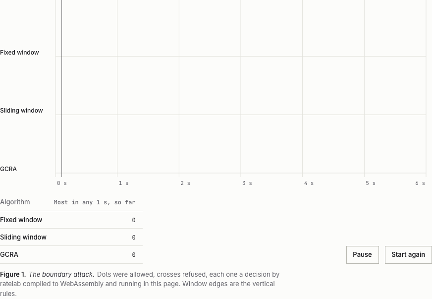
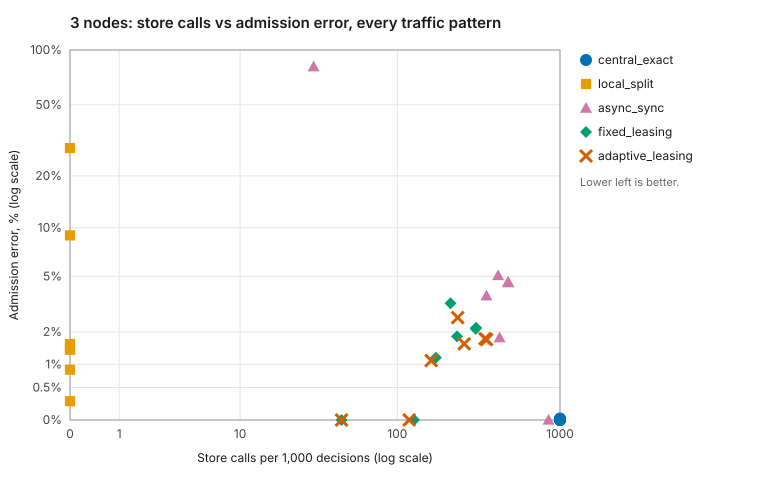
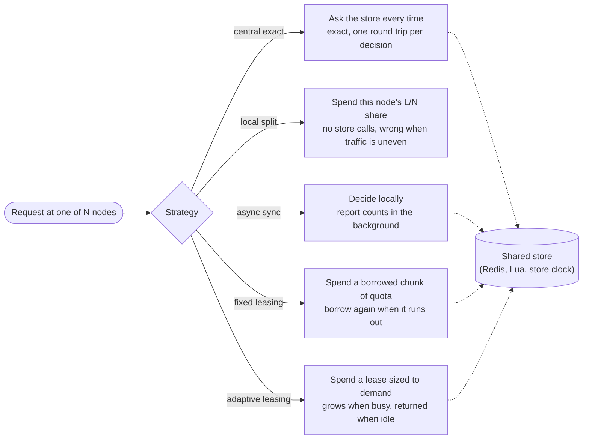

# Ratelab: distributed rate limiting, measured

<div align="center">

[](https://github.com/azzs11/distributed-rate-limiter/actions/workflows/rust.yml)
[](https://crates.io/crates/ratelab)
[](https://docs.rs/ratelab)


</div>

A Rust rate limiter that measures what exactness costs. Five algorithms, five ways for
a cluster to share one limit, adaptive concurrency limits for overload and token
budgets for LLM traffic, all scored against an exact oracle on one reproducible
benchmark, on simulated, real-cluster and real-traffic runs.

<p align="center">
  <a href="https://azzs11.github.io/distributed-rate-limiter/"></a>
</p>

<p align="center">
  <a href="https://azzs11.github.io/distributed-rate-limiter/"><b>Playground</b></a> ·
  <a href="docs/report/the-price-of-exactness.pdf"><b>Report (PDF)</b></a> ·
  <a href="results/RESULTS.md">Full results</a> ·
  <a href="https://crates.io/crates/ratelab">crates.io</a> ·
  <a href="https://docs.rs/ratelab">API docs</a> ·
  <a href="docs/GUIDE.md">Guide</a>
</p>

---

## Results

Every number here is generated from the benchmark's result files by `just results`;
none is typed in by hand.

<!-- results:start (generated by `just results`, do not edit) -->

Measured on Apple M5, 10 logical CPUs, 16 GiB RAM, macOS 27.0 (aarch64), rustc 1.100.0 (0ef1bc386 2026-11-09), release build (commit `5301e8f73c0d`, 2026-11-20T13:03:21Z). Full tables, spreads and method: [results/RESULTS.md](results/RESULTS.md).

| Algorithm | Worst window, boundary attack (× limit) | Over-admission, steady Poisson % | p50 latency ns | 1 thread, 1000 keys | Bytes/key, full window |
|---|---:|---:|---:|---:|---:|
| token_bucket | 1.00 | 20.97 | 48.2 | 26.44 M/s | 96 |
| leaky_bucket | 1.00 | 20.97 | 44.0 | 24.66 M/s | 96 |
| fixed_window | 2.00 | 23.81 | 38.2 | 27.46 M/s | 65 |
| sliding_window | 1.00 | 0.00 | 52.6 | 21.41 M/s | 2144 |
| gcra | 1.00 | 20.97 | 48.2 | 25.64 M/s | 75 |

**Coordination strategies**, 3 simulated nodes sharing one limit (every traffic pattern, lower left is better):



| Strategy | Admission error, steady % | Admission error, skewed % | Store calls / 1k, steady | p99 wait µs, steady |
|---|---:|---:|---:|---:|
| central_exact | 0.01 | 0.01 | 1000 | 965 |
| local_split | 1.40 | 28.70 | 0 | 0 |
| async_sync | 4.56 | 1.80 | 482 | 0 |
| fixed_leasing | 2.16 | 3.29 | 306 | 949 |
| adaptive_leasing | 1.73 | 2.59 | 354 | 956 |

**Real traffic** (3461612 requests from 137978 clients, NASA-HTTP (KSC, Jul–Aug 1995)): at the limit that blocks 1% under the exact rule (13 per 60 s), adaptive leasing on 3 nodes needed 1055 store calls per 1,000 decisions against 1000 for central exact, with 0.06% admission error.

**Simulator checked against the real cluster:** all five strategies on 3 real nodes and Redis, against the simulator fed the same recorded requests. Largest gap: 0.12 percentage points of admission error, 1.0% in store calls.

**Overload** (real, the server's own concurrency layer): with no limit, a ramp to 3× a backend's capacity kept 27.9% of the possible goodput; Gradient2 kept 95.9%. When the backend lost half its workers and then doubled them, a static limit tuned to the healthy backend kept 75.3% (p99 66 ms) and Gradient2 kept 96.2% (p99 97 ms).

**LLM tokens** (28185 real requests from the Azure LLM trace): reserving each request's maximum answer turned away 9.2% of all requests that an oracle knowing every answer's length would have served; admit-then-reconcile turned away 3.9%, with 0.00% overspend and debts repaid in 766 ms on average. Charging an estimate and never correcting it overspent 0.34%.

**3 nodes sharing Redis** (Docker Compose on the same machine): over-admission 1.93% compared with one perfectly coordinated token bucket, 1000 Redis calls per 1,000 decisions, p99 1.37 ms at the client, 122125 requests/s closed-loop.

<!-- results:end -->

---

## Quick start

### Use the library

```bash
cargo add ratelab
```

```rust
use ratelab::{Cost, Gcra, RateLimitConfig, RateLimiter};

let limiter = Gcra::new(RateLimitConfig::per_second(100)?);
if !limiter.check("user_42", Cost::ONE).allowed {
    // answer 429
}
```

The [API docs](https://docs.rs/ratelab) have a runnable example for every public
function. [`examples/axum-api`](examples/axum-api/src/lib.rs) shows a whole service in
about a hundred lines: a rate limit per API key with the IETF headers, and a Gradient2
concurrency limit in front of it (`cargo run -p axum-api-example`).

### The `ratelab` command

```bash
cargo install --git https://github.com/azzs11/distributed-rate-limiter ratelab-cli

ratelab simulate --traffic boundary_attack            # every algorithm on one attack
ratelab simulate --nodes 3 --traffic steady --keys 10 # every coordination strategy
ratelab replay access.log.gz --window 1m --target 1   # choose a limit from your traffic
ratelab bench --threads 4                             # quick speed check on this machine
```

`replay` reads nginx/Apache logs, CSV with a header, or JSON Lines (from a file,
gzipped or not, or `-` for stdin), and recommends the smallest limit per caller at
which the exact rule blocks no more than your target share of requests.

### Run the server

```bash
git clone https://github.com/azzs11/distributed-rate-limiter.git && cd distributed-rate-limiter

cargo run -p server --bin web-server                           # in-process limiter on :3001
cargo run -p server --bin web-server -- --concurrency gradient2  # also shed overload with 503
cargo run -p server --bin web-server -- --llm                  # mock LLM with token limits

curl -i -H 'x-api-key: alice' localhost:3001/api/hello
```

Shared through Redis instead: start Redis (`docker run --rm -p 6379:6379 redis:7.4-alpine`)
and add `--backend redis`, or `--backend strategy --strategy adaptive_leasing` for a
coordination strategy. Every answer carries the IETF `RateLimit-Policy` and `RateLimit`
headers, and `Retry-After` on a `429`.

### Three nodes in Docker

```bash
just cluster        # 3 Axum nodes + Redis + a load generator (deploy/docker-compose.yml)
```

---

## How a cluster shares one limit



Every strategy is an I/O-free state machine in `ratelab::strategies`. The same code
runs in the deterministic simulator, in the real server against Redis, and in the
browser, so the simulator can be checked against a real cluster request for request.
The [guide](docs/GUIDE.md#features) describes every algorithm, the Redis store, the
server, the concurrency limits and the token budgets.

---

## Reproduce the numbers

```bash
just results       # everything; needs Docker; downloads go to memory and are discarded
```

It runs the in-process suite, memory per key, the strategy simulation, a real public
request log, overload, LLM tokens on a real trace, the 3-node Docker cluster and every
strategy on that cluster against the simulator, then writes
[results/RESULTS.md](results/RESULTS.md), the charts and the block above. Each step,
and the method, is in the [guide](docs/GUIDE.md#reproducing-the-numbers).

## Report

**[The Price of Exactness in Distributed Rate Limiting](docs/report/the-price-of-exactness.pdf)**
([Markdown](docs/report/the-price-of-exactness.md)): six pages on the method and the
results, generated from the same result files, so its numbers always match these.

## Limitations

- **Cluster run:** the nodes, Redis and the load generator share one machine and
  Docker's network, so the cluster numbers show the protocol's behaviour, not a
  production deployment.
- **Strategy simulation:** the network is a model (fixed delay plus jitter). It is
  checked against the real cluster (`just cluster-strategies`): both sides get the same
  recorded requests, and RESULTS.md reports the largest gap.
- **Real traffic:** the public log is from 1995 and has one-second timestamps; it shows
  how real clients behave (many sparse, a few heavy), not today's API volumes.
- **LLM tokens:** the Azure trace has no user ids, so requests are spread over tenants
  by a seeded draw, and it records token counts but not timings, so answers stream at
  an assumed speed.
- **Overload:** the backend is a model (a worker pool with random service times), and
  the real run drives the Axum router in-process, without a network, so it measures the
  limiter and the server rather than a deployment.
- **Latency on macOS:** the clock ticks too coarsely to time one call, so latency is
  timed in batches of calls (see RESULTS.md).

## Roadmap

- **Multi-tier limits:** per user, IP, endpoint and global limits combined, from a
  policy file with hot reload.
- **Stretch:** an Envoy-compatible gRPC rate limit service, a multi-region mode, and a
  TLA+ model of the leasing protocol.

The phase plan is in [docs/ROADMAP.md](docs/ROADMAP.md).

## License

MIT. See [LICENSE](LICENSE). By [Akchhya Singh](https://github.com/azzs11)
([LinkedIn](https://linkedin.com/in/akchhya-singh11)).
