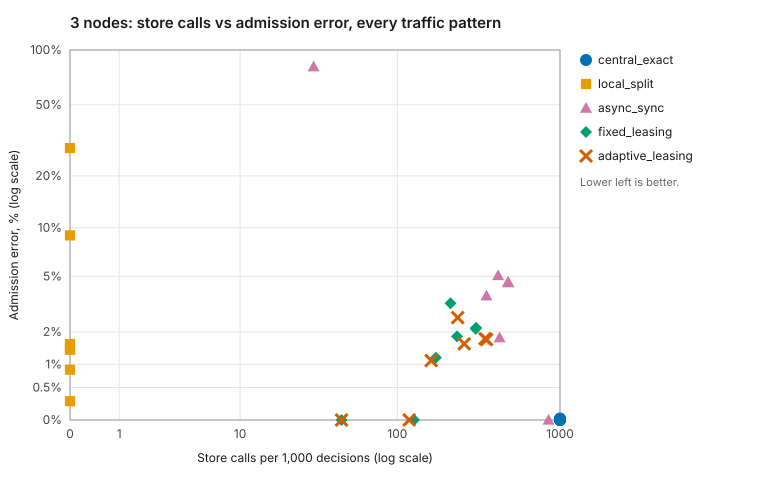
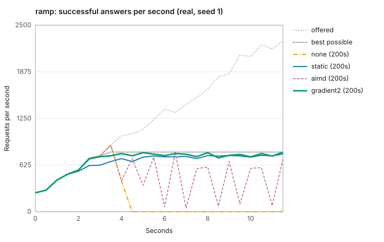
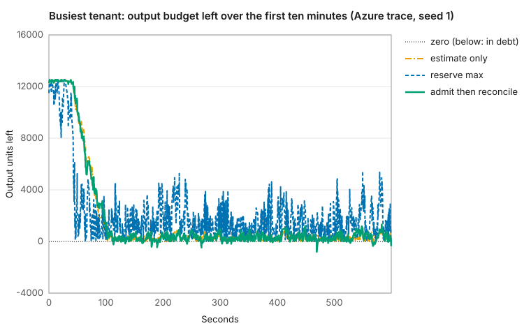

# The Price of Exactness in Distributed Rate Limiting

**Akchhya Singh** · {{date}} · <https://github.com/azzs11/distributed-rate-limiter>

> **Abstract.** A rate limit promises at most *L* requests per window. On one machine
> the promise can be kept exactly; across a cluster it costs a round trip to shared
> state on every request. We measure that cost and what each cheaper alternative gives
> up, using one reproducible benchmark that scores every limiter against an exact
> oracle. On {{strat.seeds}} seeds of simulated traffic over three nodes, adaptive quota
> leasing (leases that grow with use and are returned when idle) answered with
> {{s3.adaptive_leasing.steady_poisson.saved_pct}}% fewer store calls than a central
> exact limiter at {{s3.adaptive_leasing.steady_poisson.err}}% admission error, and the
> simulator agreed with a real three-node Redis deployment to within
> {{realcheck.err_gap_pp}} percentage points. On a real public request log, however,
> leasing saved nothing, because most real clients send too little to reuse a lease. We
> extend the comparison to two neighbouring problems: overload, where an adaptive
> concurrency limit kept {{ov.ramp.gradient2.goodput}}% of the possible goodput under a
> ramp to {{ov.ramp.peak_x}}× capacity against {{ov.ramp.none.goodput}}% with no limit,
> and LLM traffic, where reserving each request's maximum answer turned away
> {{llm.reserve_max.wrong}}% of requests that an oracle would have served, against
> {{llm.admit_then_reconcile.wrong}}% for charging an estimate and reconciling later.

## 1. Introduction

Rate limits protect services from overload and tenants from each other. Production
limiters run on many servers at once, and the textbook algorithms assume one. A
cluster that must enforce one limit has three broad choices: ask a shared store on
every request (exact, one round trip per decision), split the limit between the nodes
(free, wrong whenever traffic is uneven), or something in between: synchronise counts
in the background, or lease chunks of quota from the store and spend them locally.

Each choice trades accuracy for traffic to the store, and that trade is usually
described rather than measured. This work measures it. Its contributions are:

1. **One benchmark for all of them.** Five single-node algorithms and five coordination
   strategies run against the same traffic and are scored against an exact oracle
   (Section 3), with every number in this report generated from the benchmark's result
   files.
2. **Adaptive quota leasing**, a leasing protocol whose lease size follows each node's
   demand like a TCP window, measured against the alternatives, including where it
   loses (Section 4.3).
3. **A simulator checked against a real cluster**, so that its results can be trusted
   for configurations a laptop cannot run (Section 4.4).
4. **Two neighbouring problems on the same footing:** adaptive concurrency limits under
   overload (Section 5) and token budgets for LLM traffic, whose cost is known only
   after the answer has streamed (Section 6), the latter on a real production trace.

## 2. Background

**Algorithms.** A *fixed window* counts requests per aligned window and resets at every
edge. A *sliding window log* keeps every admitted request of the last window and is
exact. A *token bucket* (equivalently a *leaky bucket*) holds up to *L* tokens and
refills *L* per window; *GCRA* makes the token bucket's decisions with one timestamp
per key. The fixed window's flaw is well known and easy to reproduce: *L* requests just
before an edge and *L* just after both fit, and the benchmark measured
{{attack.fixed.worst}}× the limit admitted within one second. The buckets have a
gentler version of the same property by design: a full bucket admits a burst on top of
a window of refill, and on steady Poisson traffic they admitted {{steady.bucket.over_pct}}%
more than the exact rule.

**Coordination strategies.** *Central exact* asks the store (Redis, in a Lua script
using the store's clock) on every request. *Local split* gives each of *N* nodes *L/N*
and never talks. *Local with async sync* decides locally and reports counts in the
background, in the style Cloudflare has described for its edge. *Fixed quota leasing*
borrows fixed chunks of the limit from the store and spends them locally. *Adaptive
quota leasing* doubles a node's lease when it is used up quickly, halves it when the
store grants less than asked, and returns leftovers when the node goes idle, so busy
nodes borrow more and idle nodes do not hoard.

## 3. Method

**The oracle.** Admission error is measured against one perfectly coordinated token
bucket that sees every request of the cluster in order: units admitted above it, or
refused below it, per key and per window, as a share of its admissions. Single-node
accuracy is measured against a sliding window log, which admits exactly what the rule
allows. Neither shares code with the library.

**The simulator.** A deterministic discrete-event simulator runs *N* nodes, a store, a
network with one-way delay ({{strat.delay_us}} µs plus jitter in the main runs), clock
skew and store outages. Strategies are implemented once, as I/O-free state machines,
and the same code runs in the simulator, in the real server and in the browser.

**The real cluster.** Three Axum servers and Redis run in Docker Compose on one laptop,
driven by a load generator that records every request. The recorded requests (same
times, same nodes) are then replayed through the simulator, so the two can be compared
request for request.

**Traffic.** Generated scenarios (steady Poisson, on/off bursts, heavy-tailed Pareto
gaps, a diurnal ramp, a flash crowd, a uniform and a skewed split across nodes, and the
boundary attack) run for {{strat.secs}} s with {{strat.keys}} keys at a limit of
{{strat.limit}} per second, over {{strat.seeds}} seeds; tables report the mean. Real
traffic comes from two public logs, fetched when the benchmark runs and never stored:
every HTTP request to NASA's Kennedy Space Center web server in July and August 1995,
and the Azure LLM inference trace of November 2023 ({{llm.citation}}).

**Machine.** Unless stated otherwise: {{machine}}. Every result file records its own
machine and commit.

## 4. Results

### 4.1 One node

On one node the choice of algorithm is mostly a choice of memory. The median decision
took between {{latency.p50.min_ns}} and {{latency.p50.max_ns}} ns for every algorithm
({{latency.keys}} keys, timed in batches because the laptop's clock ticks too coarsely
to time one call). GCRA kept {{mem.gcra}} bytes per key against {{mem.sliding}} for the
exact sliding window log, {{mem.sliding_over_gcra}}× less, while making the token
bucket's decisions. One shared GCRA limiter made {{tput.gcra.1t}} million decisions per
second on one thread; the fastest configuration measured, the {{tput.max.algorithm}} on
{{tput.max.threads}} threads, made {{tput.max}} million.

### 4.2 The price of exactness

*Figure 1. Store calls against admission error for every strategy and traffic pattern
on three simulated nodes (log scales; lower left is better).*

| Strategy (3 nodes) | Error, steady % | Error, skewed % | Store calls / 1k, steady | Store calls / 1k, skewed |
|---|---:|---:|---:|---:|
| Central exact | {{s3.central_exact.steady_poisson.err}} | {{s3.central_exact.skewed.err}} | {{s3.central_exact.steady_poisson.calls}} | {{s3.central_exact.skewed.calls}} |
| Local split | {{s3.local_split.steady_poisson.err}} | {{s3.local_split.skewed.err}} | {{s3.local_split.steady_poisson.calls}} | {{s3.local_split.skewed.calls}} |
| Local + async sync | {{s3.async_sync.steady_poisson.err}} | {{s3.async_sync.skewed.err}} | {{s3.async_sync.steady_poisson.calls}} | {{s3.async_sync.skewed.calls}} |
| Fixed leasing | {{s3.fixed_leasing.steady_poisson.err}} | {{s3.fixed_leasing.skewed.err}} | {{s3.fixed_leasing.steady_poisson.calls}} | {{s3.fixed_leasing.skewed.calls}} |
| Adaptive leasing | {{s3.adaptive_leasing.steady_poisson.err}} | {{s3.adaptive_leasing.skewed.err}} | {{s3.adaptive_leasing.steady_poisson.calls}} | {{s3.adaptive_leasing.skewed.calls}} |

*Table 1. Admission error and store calls on three simulated nodes ({{strat.seeds}} seeds).*

The extremes behave as expected. Central exact is exact and pays one store call per
decision. Local split never calls the store and is accurate only while traffic is even:
when one node received most of the traffic its error reached
{{s3.local_split.skewed.err}}%. Between them, leasing used
{{s3.fixed_leasing.steady_poisson.saved_pct}}% (fixed) and
{{s3.adaptive_leasing.steady_poisson.saved_pct}}% (adaptive) fewer store calls than
central exact on steady traffic, at a few percent of admission error, and stayed close
to that under skew, where local split broke down.

Two robustness results matter in practice. With node clocks skewed by up to ±{{skew.ms}} ms, a central
limiter that trusted the nodes' clocks (as an application-side Lua script would) reached
{{skew.node_clock.err}}% admission error, while every strategy that uses the store's
clock was unaffected; adaptive leasing stayed at {{skew.adaptive.err}}%. After all
traffic moved from one node to another, adaptive leasing took {{conv.adaptive_leasing.ms}}
ms on average to rebalance, against {{conv.fixed_leasing.ms}} ms for fixed leasing.

### 4.3 Where adaptive leasing loses

The benchmark lists every configuration in which another strategy had both fewer (or
equal) store calls and less (or equal) admission error than adaptive leasing. That
happened in {{adaptive.beaten}} of {{adaptive.configs}} configurations, and in
{{adaptive.beaten_multinode}} of the multi-node ones; most of the rest are single-node
runs, where splitting the limit is exact and free. Against fixed leasing, over the
{{adaptive.multinode}} multi-node configurations, adaptive leasing used fewer store
calls in {{adaptive.fewer_calls_than_fixed}} and had less admission error in
{{adaptive.less_error_than_fixed}}. Adaptive leasing is a better default than a fixed
lease size, not a free lunch.

### 4.4 The simulator, checked

Every strategy also ran on {{realcheck.nodes}} real Axum nodes sharing a real Redis,
over {{realcheck.seeds}} seeds of uniform and skewed traffic, and the simulator replayed
the same recorded requests. The largest difference between them was
{{realcheck.err_gap_pp}} percentage points of admission error and
{{realcheck.calls_gap_pct}}% in store calls. On the same cluster, sharing one Redis
token bucket admitted {{cluster.over_pct}}% more than one perfectly coordinated bucket,
with a p99 of {{cluster.p99_ms}} ms at the client, and served {{cluster.rps}} requests
per second closed-loop.

### 4.5 Real traffic

The NASA log holds {{trace.requests}} requests from {{trace.clients}} clients over
{{trace.days}} days. With the smallest limit at which the exact rule blocks at most
{{trace.target_pct}}% of requests ({{trace.limit}} per {{trace.window_s}} s per client),
the fixed window again admitted {{trace.fixed.worst}}× the limit in its worst second.
The surprise was leasing: on three nodes adaptive leasing made
{{trace.adaptive_leasing.3.calls}} store calls per 1,000 decisions, against
{{trace.central_exact.3.calls}} for central exact. Most real clients send a few
requests and leave, so a lease is rarely reused before it expires; generated traffic,
with a handful of busy keys, had hidden this. Local split, meanwhile, reached
{{trace.local_split.8.err}}% error on eight nodes. Real traffic also exposed a
performance bug: two strategies did work for every client ever seen on every tick,
which is harmless with ten keys and fatal with a hundred thousand.

## 5. Overload

A rate limit protects a service from a client; it does not protect a service from
itself. When a backend slows down, a rate limit keeps admitting the same rate, queues
grow past the clients' deadlines, and a backend that does not cancel late work spends
its capacity on answers nobody is waiting for. A concurrency limit caps requests in
flight instead and refuses the excess at once.

We put a backend with {{ov.workers}} workers and a mean service time of
{{ov.service_ms}} ms ({{ov.capacity}} requests per second) behind a {{ov.deadline_ms}} ms
deadline and compared no limit, a static limit equal to the healthy worker count, AIMD
and Gradient2 (following Netflix's concurrency-limits), on the server's real Tower layer
and in the simulator with the same requests.

*Figure 2. Answers within the deadline per second as load ramps to
{{ov.ramp.peak_x}}× capacity.*

| Limit | Ramp: goodput % | Ramp: p99 ms | Capacity change: goodput % | Capacity change: p99 ms |
|---|---:|---:|---:|---:|
| None | {{ov.ramp.none.goodput}} | {{ov.ramp.none.p99_ms}} | {{ov.cap.none.goodput}} | {{ov.cap.none.p99_ms}} |
| Static | {{ov.ramp.static.goodput}} | {{ov.ramp.static.p99_ms}} | {{ov.cap.static.goodput}} | {{ov.cap.static.p99_ms}} |
| AIMD | {{ov.ramp.aimd.goodput}} | {{ov.ramp.aimd.p99_ms}} | {{ov.cap.aimd.goodput}} | {{ov.cap.aimd.p99_ms}} |
| Gradient2 | {{ov.ramp.gradient2.goodput}} | {{ov.ramp.gradient2.p99_ms}} | {{ov.cap.gradient2.goodput}} | {{ov.cap.gradient2.p99_ms}} |

*Table 2. Goodput as a share of what the backend could have served, and p99 latency of
the successful answers, on the real layer. The capacity change halves the workers, then
doubles them.*

With no limit, {{ov.ramp.none.timeout_pct}}% of requests timed out during the ramp. A
static limit works while the backend stays the size it was tuned for, and cannot use
added capacity. AIMD learns only from timeouts, so its slowest answers sat near the
deadline. Gradient2, which reacts when recent latency rises above its long-term
average, served the most in both scenarios; the static limit answered faster by turning
more away. The real layer and the simulator differed by at most {{ov.gap_pp}} points of
goodput.

## 6. LLM traffic: paying for answers not yet written

An LLM request costs its prompt, known on arrival, and its answer, known only when the
last token has streamed. A limiter must decide before then. We compare three ways to
charge the output: *estimate-only* charges a learned estimate and never corrects it;
*reserve-max* holds the request's maximum answer and refunds the rest; *admit then
reconcile* charges the estimate and settles the difference when the stream ends, letting
the tenant run into debt that the refill repays. An oracle that knows every answer's
length sets the bar.

On {{llm.requests}} real requests ({{llm.minutes}} minutes of the Azure trace, spread
over {{llm.tenants}} tenants by a seeded draw because the trace has no user ids), with
limits at which the oracle refuses {{llm.oracle_blocked}}%:

| Charging | Refused % | Turned away vs oracle % | Overspend % | Debts (mean repaid in) |
|---|---:|---:|---:|---:|
| Estimate only | {{llm.estimate_only.blocked}} | {{llm.estimate_only.wrong}} | {{llm.estimate_only.overspend}} | – |
| Reserve the maximum | {{llm.reserve_max.blocked}} | {{llm.reserve_max.wrong}} | {{llm.reserve_max.overspend}} | – |
| Admit, then reconcile | {{llm.admit_then_reconcile.blocked}} | {{llm.admit_then_reconcile.wrong}} | {{llm.admit_then_reconcile.overspend}} | {{llm.admit_then_reconcile.debts}} ({{llm.admit_then_reconcile.repaid_ms}} ms) |

*Table 3. Token accounting on the Azure LLM trace.*

*Figure 3. The busiest tenant's output budget over ten minutes. Reserve-the-maximum
holds budget that most answers never use; reconcile hovers at zero with brief debts.*

Reserving the maximum is the conservative choice and the costly one: most answers are
far shorter than their maximum, so it turned away {{llm.reserve_max.wrong}}% of requests
the oracle would have served. Estimate-only overspent less than expected,
{{llm.estimate_only.overspend}}%, because a learned average errs in both directions and
over an hour the errors cancel. Admit-then-reconcile kept overspend at
{{llm.admit_then_reconcile.overspend}}% and turned away {{llm.admit_then_reconcile.wrong}}%,
with debts repaid in {{llm.admit_then_reconcile.repaid_ms}} ms on average. The same
requests through the server's real token layer, streaming in real time, matched the
simulator to within {{llm.real.blocked_gap_pp}} points of refusals.

## 7. Limitations

The cluster shares one laptop and Docker's network, so absolute latencies describe the
protocol, not a deployment. The simulated network is a model (fixed delay plus jitter),
checked against the real cluster only at three nodes. The NASA log is from 1995 and has
one-second timestamps; the Azure trace has no user ids and records token counts, not
timings, so answers stream at an assumed speed. The overload backend is a worker-pool
model. Every result names the machine and commit it was measured on, and one command
(`just results`) reproduces all of them.

## 8. Related work

Envoy separates local limits from a global rate limit service queried over gRPC.
Cloudflare has described counting locally and synchronising asynchronously at its edge.
The Rust `governor` crate implements GCRA efficiently on one node. Netflix's
concurrency-limits library introduced the AIMD and Gradient2 limits measured here, and
Envoy's AI gateway charges LLM requests by tokens per model. The IETF RateLimit header
draft standardises how limits are reported to clients, which the server implements.
This work's contribution is not a new algorithm in any of these families but a single,
reproducible measurement across them, and an adaptive leasing protocol evaluated
honestly against its alternatives.

## 9. Conclusion

Exactness in distributed rate limiting has a price, and it can be measured: one store
call per decision buys an exact limit; quota leasing returns most of that cost for a
few percent of error on traffic dominated by busy clients, and returns nothing on
traffic dominated by sparse ones. The right strategy depends on the traffic, which is
why the benchmark ships with a log replay that measures every strategy on yours. The
same discipline applies beyond request counts: under overload an adaptive concurrency
limit keeps goodput where a fixed rate collapses, and for LLM traffic, charging an
estimate and reconciling afterwards serves far more requests than reserving the
worst case.

**Reproducing.** Code, data pipeline and results: <https://github.com/azzs11/distributed-rate-limiter>.
The library is published as `ratelab` on crates.io, and an interactive version of every
figure runs in the browser at <https://azzs11.github.io/distributed-rate-limiter/>.
