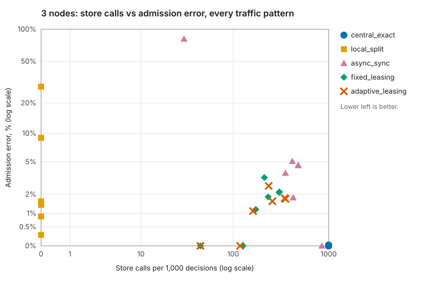
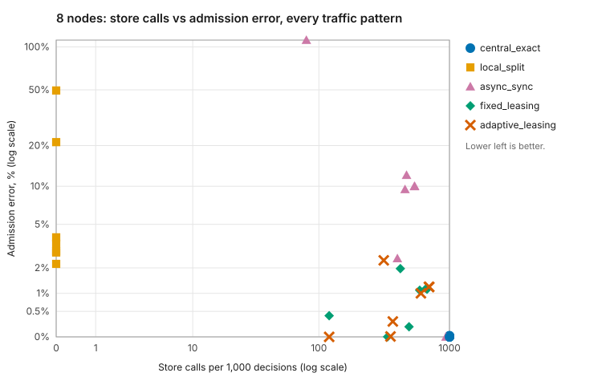

# Results

Generated by `just results` from the JSON files in this folder. **Do not edit by hand**; rerun the command instead. Values are `mean (min–max)` over the runs or seeds listed.

## Machines

- **In-process suite:** Apple M5, 10 logical CPUs, 16 GiB RAM, macOS 27.0 (aarch64), rustc 1.100.0 (0ef1bc386 2026-11-09), release build · commit `4076abe200b4` · 2026-11-20T10:54:12Z
- **Memory:** Apple M5, 10 logical CPUs, 16 GiB RAM, macOS 27.0 (aarch64), rustc 1.100.0 (0ef1bc386 2026-11-09), release build · commit `4076abe200b4` · 2026-11-20T10:54:47Z
- **Strategy simulation:** Apple M5, 10 logical CPUs, 16 GiB RAM, macOS 27.0 (aarch64), rustc 1.100.0 (0ef1bc386 2026-11-09), release build · commit `4076abe200b4` · 2026-11-20T10:54:53Z
- **Cluster (inside the containers):** unknown, 10 logical CPUs, 8 GiB RAM, Debian GNU/Linux 13 (trixie) (Linux 7.0.14-linuxkit) (aarch64), rustc 1.100.0 (0ef1bc386 2026-11-09), release build · commit `4076abe200b4` · 2026-11-20T10:59:44Z
- **Cluster host:** Apple M5, 10 logical CPUs, 16 GiB RAM, macOS 27.0 (aarch64), rustc 1.100.0 (0ef1bc386 2026-11-09), release build · commit `4076abe200b4`

## Accuracy against the exact oracle

The oracle admits a request exactly when the key stays within 100 units in every 1 s span. Each scenario has 10 keys and lasts 30 s; seeded scenarios run 5 seeds. **Over** = allowed by the limiter but not by the oracle, **under** = the reverse, both as % of requests. **Worst window** = the most units one key got in any 1 s span, as a multiple of the limit.

### steady_poisson (59947 (59579–60112) requests per run)

| Algorithm | Over % | Under % | Admitted vs oracle % | Worst window × limit |
|---|---:|---:|---:|---:|
| token_bucket | 20.97 (20.86–21.15) | 19.08 (18.99–19.22) | 3.79 (3.74–3.85) | 1.99 |
| leaky_bucket | 20.97 (20.86–21.15) | 19.08 (18.99–19.22) | 3.79 (3.74–3.85) | 1.99 |
| fixed_window | 23.81 (23.36–24.01) | 23.56 (23.12–23.79) | 0.49 (0.45–0.56) | 1.37 (1.33–1.40) |
| sliding_window | 0.00 | 0.00 | 0.00 | 1.00 |
| gcra | 20.97 (20.86–21.15) | 19.08 (18.99–19.22) | 3.79 (3.74–3.85) | 1.99 |

### on_off (59957 (59591–60121) requests per run)

| Algorithm | Over % | Under % | Admitted vs oracle % | Worst window × limit |
|---|---:|---:|---:|---:|
| token_bucket | 24.75 (24.67–24.89) | 0.00 | 98.91 (98.88–98.93) | 1.99 |
| leaky_bucket | 24.75 (24.67–24.89) | 0.00 | 98.91 (98.88–98.93) | 1.99 |
| fixed_window | 0.00 | 0.00 | 0.00 | 1.00 |
| sliding_window | 0.00 | 0.00 | 0.00 | 1.00 |
| gcra | 24.75 (24.67–24.89) | 0.00 | 98.91 (98.88–98.93) | 1.99 |

### heavy_tailed (59967 (59767–60079) requests per run)

| Algorithm | Over % | Under % | Admitted vs oracle % | Worst window × limit |
|---|---:|---:|---:|---:|
| token_bucket | 21.19 (21.03–21.30) | 19.22 (19.08–19.30) | 3.97 (3.92–4.05) | 1.99 |
| leaky_bucket | 21.19 (21.03–21.30) | 19.22 (19.08–19.30) | 3.97 (3.92–4.05) | 1.99 |
| fixed_window | 23.99 (23.42–25.43) | 23.66 (23.06–25.05) | 0.68 (0.62–0.77) | 1.41 (1.38–1.49) |
| sliding_window | 0.00 | 0.00 | 0.00 | 1.00 |
| gcra | 21.19 (21.03–21.30) | 19.22 (19.08–19.30) | 3.97 (3.92–4.05) | 1.99 |

### diurnal (67460 (67108–67692) requests per run)

| Algorithm | Over % | Under % | Admitted vs oracle % | Worst window × limit |
|---|---:|---:|---:|---:|
| token_bucket | 16.41 (16.31–16.52) | 14.64 (14.52–14.74) | 4.17 (4.09–4.24) | 1.72 (1.70–1.75) |
| leaky_bucket | 16.41 (16.31–16.52) | 14.64 (14.52–14.74) | 4.17 (4.09–4.24) | 1.72 (1.70–1.75) |
| fixed_window | 20.80 (20.29–21.38) | 20.33 (19.86–20.96) | 1.09 (0.99–1.21) | 1.40 (1.36–1.50) |
| sliding_window | 0.00 | 0.00 | 0.00 | 1.00 |
| gcra | 16.41 (16.31–16.52) | 14.64 (14.52–14.74) | 4.17 (4.09–4.24) | 1.72 (1.70–1.75) |

### flash_crowd (119919 (119499–120428) requests per run)

| Algorithm | Over % | Under % | Admitted vs oracle % | Worst window × limit |
|---|---:|---:|---:|---:|
| token_bucket | 7.24 (6.95–7.52) | 0.02 (0.00–0.03) | 7.79 (7.46–8.13) | 1.42 (1.38–1.47) |
| leaky_bucket | 7.24 (6.95–7.52) | 0.02 (0.00–0.03) | 7.79 (7.46–8.13) | 1.42 (1.38–1.47) |
| fixed_window | 6.25 (6.03–6.46) | 2.97 (2.80–3.10) | 3.55 (3.42–3.63) | 1.33 (1.29–1.35) |
| sliding_window | 0.00 | 0.00 | 0.00 | 1.00 |
| gcra | 7.24 (6.95–7.52) | 0.02 (0.00–0.03) | 7.79 (7.46–8.13) | 1.42 (1.38–1.47) |

### boundary_attack (200 requests per run)

| Algorithm | Over % | Under % | Admitted vs oracle % | Worst window × limit |
|---|---:|---:|---:|---:|
| token_bucket | 0.00 | 0.00 | 0.00 | 1.00 |
| leaky_bucket | 0.00 | 0.00 | 0.00 | 1.00 |
| fixed_window | 50.00 | 0.00 | 100.00 | 2.00 |
| sliding_window | 0.00 | 0.00 | 0.00 | 1.00 |
| gcra | 0.00 | 0.00 | 0.00 | 1.00 |

## Decision latency (in-process)

One thread, 1000 keys. Each sample times a batch of 100 calls and divides by 100, because one call can be shorter than the clock's resolution (41 ns on this machine; an empty timed section reads as 0 ns, median). 20000 samples per run, 5 runs after a warm-up. Percentiles are of these per-call averages, so single slow calls inside a batch are smoothed.

| Algorithm | p50 ns | p99 ns | p99.9 ns |
|---|---:|---:|---:|
| token_bucket | 46.7 (39.6–48.8) | 56.8 (51.7–62.1) | 132.2 (123.8–139.6) |
| leaky_bucket | 42.8 (37.1–46.7) | 54.2 (50.4–57.5) | 126.0 (97.5–141.2) |
| fixed_window | 37.1 | 42.2 (38.8–48.8) | 112.7 (82.5–138.8) |
| sliding_window | 58.2 (57.1–58.8) | 78.2 (67.5–110.0) | 134.8 (82.5–210.4) |
| gcra | 47.6 (47.5–47.9) | 71.4 (54.6–117.5) | 251.9 (126.2–642.5) |

## Throughput (one shared limiter)

Decisions per second across all threads, keys picked uniformly at random, 200000 checks per thread per run, 5 runs after a warm-up.

### 1 keys

| Algorithm | 1 threads | 4 threads | 8 threads | 16 threads |
|---|---:|---:|---:|---:|
| token_bucket | 26.61 M (25.75–27.40) | 12.47 M (12.42–12.57) | 11.24 M (11.16–11.30) | 8.46 M (8.45–8.48) |
| leaky_bucket | 26.25 M (22.00–28.84) | 12.74 M (12.56–12.85) | 11.27 M (11.23–11.29) | 8.32 M (8.27–8.36) |
| fixed_window | 30.72 M (28.34–32.33) | 11.99 M (11.92–12.10) | 9.37 M (8.71–10.33) | 8.21 M (8.16–8.22) |
| sliding_window | 28.31 M (25.95–36.55) | 13.15 M (13.13–13.19) | 9.27 M (9.22–9.36) | 8.25 M (8.22–8.29) |
| gcra | 27.04 M (25.63–28.01) | 11.79 M (11.73–11.87) | 8.29 M (8.22–8.39) | 9.01 M (8.96–9.10) |

### 1000 keys

| Algorithm | 1 threads | 4 threads | 8 threads | 16 threads |
|---|---:|---:|---:|---:|
| token_bucket | 25.69 M (24.72–26.57) | 39.05 M (38.80–39.53) | 43.72 M (43.55–43.97) | 50.15 M (48.90–50.77) |
| leaky_bucket | 26.02 M (23.07–28.09) | 39.13 M (37.24–40.65) | 43.37 M (43.03–43.78) | 49.80 M (49.59–49.91) |
| fixed_window | 26.67 M (25.87–29.08) | 52.92 M (52.62–53.77) | 64.93 M (64.49–65.33) | 77.51 M (75.59–81.77) |
| sliding_window | 22.19 M (19.77–25.96) | 53.38 M (50.92–55.09) | 65.34 M (64.22–66.45) | 74.53 M (73.03–76.76) |
| gcra | 25.37 M (21.32–27.83) | 51.07 M (48.45–53.18) | 58.97 M (58.31–59.91) | 62.56 M (49.08–66.75) |

### 1000000 keys

| Algorithm | 1 threads | 4 threads | 8 threads | 16 threads |
|---|---:|---:|---:|---:|
| token_bucket | 5.40 M (5.33–5.44) | 18.22 M (17.89–18.76) | 24.41 M (23.84–24.90) | 26.14 M (25.46–26.96) |
| leaky_bucket | 5.49 M (5.28–5.63) | 17.38 M (15.00–18.42) | 24.60 M (24.35–24.98) | 25.91 M (25.41–26.31) |
| fixed_window | 6.43 M (6.39–6.50) | 20.16 M (19.95–20.40) | 26.28 M (25.90–26.69) | 28.32 M (28.09–28.76) |
| sliding_window | 4.67 M (4.23–4.84) | 12.80 M (12.59–13.29) | 18.24 M (17.16–18.93) | 19.11 M (18.38–19.97) |
| gcra | 5.51 M (5.44–5.62) | 18.21 M (17.96–18.35) | 23.34 M (22.84–23.67) | 24.13 M (20.63–25.33) |

## Fairness between tenants

10 tenants share 100 requests/s for 30 s (5 seeds). Tenant 0 sends 200/s, the others 20/s each, so every tenant wants more than an equal share. **global** = one shared key with limit 100/s; **per_tenant** = one key per tenant with 10/s each. Jain's index is 1 when every tenant gets the same.

| Algorithm | Keying | Jain's index | Noisy tenant's share % |
|---|---|---:|---:|
| token_bucket | global | 0.335 (0.328–0.348) | 52.3 (51.0–52.9) |
| leaky_bucket | global | 0.335 (0.328–0.348) | 52.3 (51.0–52.9) |
| fixed_window | global | 0.329 (0.313–0.337) | 52.8 (52.0–54.5) |
| sliding_window | global | 0.327 (0.310–0.337) | 53.1 (52.1–54.7) |
| gcra | global | 0.335 (0.328–0.348) | 52.3 (51.0–52.9) |
| token_bucket | per_tenant | 1.000 | 10.0 |
| leaky_bucket | per_tenant | 1.000 | 10.0 |
| fixed_window | per_tenant | 1.000 | 10.0 |
| sliding_window | per_tenant | 0.999 (0.999–1.000) | 10.7 (10.6–10.7) |
| gcra | per_tenant | 1.000 | 10.0 |

## Memory per key

Heap bytes per key with 100000 keys, counted by the allocator. **Full window** = after 100 requests per key (limit 100).

| Algorithm | After 1 request | Full window |
|---|---:|---:|
| token_bucket | 96 | 96 |
| leaky_bucket | 96 | 96 |
| fixed_window | 65 | 65 |
| sliding_window | 160 | 2144 |
| gcra | 75 | 75 |

## 3 nodes sharing one Redis (Docker Compose)

Each node runs the Axum server with the Redis token bucket. The load generator sends open-loop Poisson traffic at 2.0× the limit to 30 keys (limit 50 per 1 s per key), 20 s per run, 5 seeds, and records every request's send time. **vs one bucket** compares with a single in-process token bucket fed the same send times: what a perfectly coordinated cluster would decide. **vs oracle** compares with the exact rule, as in the in-process tables. Redis counters come from Redis itself (`INFO`).

| Scenario | Node 0 share % | Sent/s | Over vs one bucket % | Under vs one bucket % | Over vs oracle % | Worst window × limit |
|---|---:|---:|---:|---:|---:|---:|
| uniform | 33 | 2997 (2979–3006) | 2.17 (1.51–3.90) | 2.16 (1.51–3.89) | 21.38 (21.23–21.49) | 1.98 (1.98–2.00) |
| skewed | 80 | 2997 (2979–3006) | 1.71 (1.44–2.12) | 1.71 (1.44–2.12) | 21.36 (21.25–21.54) | 1.98 |

| Scenario | Redis calls / 1k decisions | Redis commands / 1k | Redis bytes / decision | p50 ms | p99 ms | p99.9 ms | No response % |
|---|---:|---:|---:|---:|---:|---:|---:|
| uniform | 1000 | 5000 | 178 | 0.50 (0.47–0.51) | 1.40 (1.32–1.51) | 5.21 (1.99–9.75) | 0.00 |
| skewed | 1000 | 5000 | 177 | 0.52 (0.51–0.53) | 1.35 (1.30–1.44) | 2.67 (1.81–4.97) | 0.00 |

Latency is measured at the load generator and includes Docker networking. Redis commands include the 4 commands inside the Lua script (TIME, HMGET, HSET, PEXPIRE).

### Closed-loop throughput

64 requests in flight, spread over the nodes and about a million keys, 10 s per run, 5 runs after a warm-up.

| Requests/s | p50 ms | p99 ms |
|---:|---:|---:|
| 120412 (116013–125452) | 0.47 (0.46–0.48) | 1.19 (1.06–1.35) |

### Redis outage

Redis stops running scripts from 5 s to 10 s (`CLIENT PAUSE ... WRITE`) while traffic continues on both routes. `/api/hello` fails **open**, `/api/orders` fails **closed**. Each node's breaker opens after 5 consecutive failures and probes again after 1000 ms; Redis calls time out after 100 ms. Every node was answering from Redis again 520 ms after Redis recovered.

| Phase | Route (policy) | Requests | Allowed % | Over vs oracle % | Redis % | Breaker open % | Redis error % | No response % | p99 ms |
|---|---|---:|---:|---:|---:|---:|---:|---:|---:|
| before | public (open) | 7491 | 100.0 | 9.5 | 100.0 | 0.0 | 0.0 | 0.0 | 10.8 |
| during | public (open) | 7399 | 100.0 | 10.1 | 0.0 | 98.1 | 1.9 | 0.0 | 101.4 |
| after | public (open) | 7590 | 100.0 | 11.6 | 90.3 | 9.7 | 0.0 | 0.0 | 1.3 |
| before | orders (closed) | 7613 | 100.0 | 10.6 | 100.0 | 0.0 | 0.0 | 0.0 | 10.4 |
| during | orders (closed) | 7461 | 0.0 | 0.0 | 0.0 | 97.9 | 2.1 | 0.0 | 101.3 |
| after | orders (closed) | 7463 | 88.9 | 8.8 | 88.9 | 11.1 | 0.0 | 0.0 | 1.2 |

## Coordination strategies (simulated cluster)

N nodes enforce one limit of 100 per second per key together, through a shared store (what Redis runs). Traffic is the in-process scenarios at the same load (10 keys), plus **skewed**: steady Poisson with 80% of requests on node 0. Each configuration runs 20 s with 5 seeds in the deterministic simulator (`crates/sim`): one-way delay 250 µs plus up to 250 µs jitter, 100 ms timeout. The network is simulated, so these numbers describe the protocols, not a machine.

- **Admission error** = over + under, counted in units per key per 1 s window against the **ideal**: one perfectly coordinated token bucket on the same arrival times. Over = admitted above the ideal; under = missing below it; both as % of what the ideal admitted.
- **Store calls** = messages from nodes to the store per 1,000 decisions.
- **Latency** = time a request waits for its decision (0 when decided locally).

Parameters: async sync every 10 ms; fixed leases of limit/4N tokens lasting one window; adaptive leases start at limit/8N, double when used up within 100 ms, halve when the store grants less than asked, and are returned after 200 ms idle.

### 1 node

**Admission error %**

| Traffic | central_exact | local_split | async_sync | fixed_leasing | adaptive_leasing |
|---|---:|---:|---:|---:|---:|
| steady_poisson | 0.01 (0.00–0.02) | 0.00 | 0.50 (0.41–0.54) | 3.21 (3.03–3.45) | 3.20 (3.05–3.43) |
| skewed | 0.01 (0.00–0.02) | 0.00 | 0.50 (0.41–0.54) | 3.21 (3.03–3.45) | 3.20 (3.05–3.43) |
| on_off | 0.00 | 0.00 | 0.74 (0.72–0.76) | 2.29 (2.21–2.47) | 2.31 (2.22–2.46) |
| heavy_tailed | 0.02 (0.00–0.03) | 0.00 | 0.47 (0.43–0.58) | 3.31 (3.04–3.67) | 3.34 (3.09–3.72) |
| diurnal | 0.02 (0.01–0.04) | 0.00 | 0.40 (0.35–0.44) | 2.56 (2.30–2.83) | 2.58 (2.47–2.74) |
| flash_crowd | 0.00 | 0.00 | 0.00 | 0.00 (0.00–0.01) | 0.00 (0.00–0.01) |
| boundary_attack | 0.00 | 0.00 | 0.00 | 0.00 | 0.00 |

**Store calls per 1,000 decisions**

| Traffic | central_exact | local_split | async_sync | fixed_leasing | adaptive_leasing |
|---|---:|---:|---:|---:|---:|
| steady_poisson | 1000 | 0 | 386 | 127 | 139 |
| skewed | 1000 | 0 | 386 | 127 | 139 |
| on_off | 1000 | 0 | 224 | 62 | 67 |
| heavy_tailed | 1000 | 0 | 383 | 126 | 138 |
| diurnal | 1000 | 0 | 339 | 92 | 104 |
| flash_crowd | 1000 | 0 | 631 | 41 | 46 |
| boundary_attack | 1000 | 0 | 5 | 15 | 15 |

**Decision latency p99, µs**

| Traffic | central_exact | local_split | async_sync | fixed_leasing | adaptive_leasing |
|---|---:|---:|---:|---:|---:|
| steady_poisson | 965 | 0 | 0 | 915 | 919 |
| skewed | 965 | 0 | 0 | 915 | 919 |
| on_off | 964 | 0 | 0 | 878 | 881 |
| heavy_tailed | 964 | 0 | 0 | 911 | 915 |
| diurnal | 964 | 0 | 0 | 899 | 906 |
| flash_crowd | 965 | 0 | 0 | 825 | 832 |
| boundary_attack | 954 | 0 | 0 | 1554 | 1554 |

### 3 nodes



**Admission error %**

| Traffic | central_exact | local_split | async_sync | fixed_leasing | adaptive_leasing |
|---|---:|---:|---:|---:|---:|
| steady_poisson | 0.01 (0.00–0.02) | 1.40 (1.25–1.64) | 4.56 (4.49–4.62) | 2.16 (1.97–2.38) | 1.73 (1.64–1.78) |
| skewed | 0.01 (0.00–0.02) | 28.70 (28.28–29.13) | 1.80 (1.57–1.95) | 3.29 (3.07–3.60) | 2.59 (2.30–2.95) |
| on_off | 0.00 | 0.87 (0.82–0.93) | 3.72 (3.62–3.78) | 1.17 (1.04–1.33) | 1.10 (1.03–1.18) |
| heavy_tailed | 0.02 (0.00–0.03) | 1.42 (1.19–1.74) | 4.60 (4.47–4.80) | 2.12 (1.93–2.19) | 1.76 (1.59–1.90) |
| diurnal | 0.02 (0.01–0.04) | 1.58 (1.44–1.75) | 5.08 (4.87–5.22) | 1.84 (1.76–1.95) | 1.59 (1.45–1.70) |
| flash_crowd | 0.00 | 0.26 (0.19–0.36) | 0.00 | 0.00 (0.00–0.01) | 0.00 (0.00–0.01) |
| boundary_attack | 0.00 | 9.00 (7.00–15.00) | 81.20 (79.00–85.00) | 0.00 | 0.00 |

**Store calls per 1,000 decisions**

| Traffic | central_exact | local_split | async_sync | fixed_leasing | adaptive_leasing |
|---|---:|---:|---:|---:|---:|
| steady_poisson | 1000 | 0 | 482 | 306 | 354 |
| skewed | 1000 | 0 | 426 | 213 | 236 |
| on_off | 1000 | 0 | 354 | 173 | 162 |
| heavy_tailed | 1000 | 0 | 480 | 304 | 347 |
| diurnal | 1000 | 0 | 417 | 233 | 258 |
| flash_crowd | 1000 | 0 | 850 | 127 | 118 |
| boundary_attack | 1000 | 0 | 30 | 45 | 45 |

**Decision latency p99, µs**

| Traffic | central_exact | local_split | async_sync | fixed_leasing | adaptive_leasing |
|---|---:|---:|---:|---:|---:|
| steady_poisson | 965 | 0 | 0 | 949 | 956 |
| skewed | 965 | 0 | 0 | 938 | 941 |
| on_off | 964 | 0 | 0 | 929 | 925 |
| heavy_tailed | 964 | 0 | 0 | 946 | 951 |
| diurnal | 964 | 0 | 0 | 941 | 947 |
| flash_crowd | 965 | 0 | 0 | 900 | 895 |
| boundary_attack | 954 | 0 | 0 | 1610 | 1610 |

### 8 nodes



**Admission error %**

| Traffic | central_exact | local_split | async_sync | fixed_leasing | adaptive_leasing |
|---|---:|---:|---:|---:|---:|
| steady_poisson | 0.01 (0.00–0.02) | 2.83 (2.50–3.39) | 10.02 (9.88–10.33) | 1.13 (1.09–1.22) | 1.21 (1.03–1.43) |
| skewed | 0.01 (0.00–0.02) | 49.52 (49.11–49.96) | 2.48 (2.26–2.66) | 1.96 (1.85–2.05) | 2.38 (2.22–2.65) |
| on_off | 0.00 | 3.88 (3.83–3.96) | 9.46 (9.17–9.73) | 0.17 (0.16–0.19) | 0.28 (0.21–0.34) |
| heavy_tailed | 0.02 (0.00–0.03) | 2.91 (2.69–3.18) | 9.97 (9.81–10.23) | 1.17 (1.02–1.37) | 1.22 (1.07–1.39) |
| diurnal | 0.02 (0.01–0.04) | 3.40 (3.14–3.67) | 12.14 (11.85–12.61) | 1.10 (1.05–1.16) | 1.00 (0.97–1.06) |
| flash_crowd | 0.00 | 2.20 (2.14–2.24) | 0.00 | 0.00 | 0.01 (0.00–0.02) |
| boundary_attack | 0.00 | 21.20 (14.00–26.00) | 111.60 (107.00–115.00) | 0.40 (0.00–2.00) | 0.00 |

**Store calls per 1,000 decisions**

| Traffic | central_exact | local_split | async_sync | fixed_leasing | adaptive_leasing |
|---|---:|---:|---:|---:|---:|
| steady_poisson | 1000 | 0 | 542 | 674 | 701 |
| skewed | 1000 | 0 | 400 | 422 | 314 |
| on_off | 1000 | 0 | 457 | 491 | 369 |
| heavy_tailed | 1000 | 0 | 540 | 669 | 697 |
| diurnal | 1000 | 0 | 470 | 592 | 605 |
| flash_crowd | 1000 | 0 | 940 | 337 | 354 |
| boundary_attack | 1000 | 0 | 80 | 120 | 120 |

**Decision latency p99, µs**

| Traffic | central_exact | local_split | async_sync | fixed_leasing | adaptive_leasing |
|---|---:|---:|---:|---:|---:|
| steady_poisson | 965 | 0 | 0 | 966 | 967 |
| skewed | 965 | 0 | 0 | 975 | 948 |
| on_off | 964 | 0 | 0 | 961 | 952 |
| heavy_tailed | 964 | 0 | 0 | 963 | 964 |
| diurnal | 964 | 0 | 0 | 964 | 966 |
| flash_crowd | 965 | 0 | 0 | 938 | 938 |
| boundary_attack | 954 | 0 | 0 | 1689 | 1689 |

### Clock skew

Steady traffic on 3 nodes whose clocks are offset by [-50, 0, 50] ms. **central_exact_node_clock** lets each node send its own time to the store, as an application-clock script does (it stores the caller's time as is); **central_exact** uses the store's clock, like Redis `TIME`.

| Strategy | Error, no skew % | Error, skewed % | Over-admission, skewed % |
|---|---:|---:|---:|
| central_exact | 0.01 (0.00–0.02) | 0.01 (0.00–0.02) | 0.00 (0.00–0.01) |
| central_exact_node_clock | 0.14 (0.12–0.15) | 89.87 (89.19–90.66) | 89.87 (89.19–90.66) |
| local_split | 1.40 (1.25–1.64) | 1.40 (1.25–1.64) | 0.61 (0.55–0.73) |
| async_sync | 4.56 (4.49–4.62) | 4.56 (4.49–4.62) | 4.54 (4.47–4.60) |
| fixed_leasing | 2.16 (1.97–2.38) | 2.16 (1.97–2.38) | 1.01 (0.90–1.10) |
| adaptive_leasing | 1.73 (1.64–1.78) | 1.73 (1.64–1.78) | 0.82 (0.78–0.85) |

### Store outage

Steady traffic on 3 nodes; the store is unreachable from 40% to 60% of the run. Errors here are counted only for requests that arrived during the outage.

| Strategy | Policy | Allowed during % | Over during % | Under during % | Error, whole run % |
|---|---|---:|---:|---:|---:|
| central_exact | fail open | 100.0 | 98.9 | 0.0 | 23.62 (23.39–23.98) |
| central_exact | fail closed | 0.0 | 0.0 | 100.0 | 23.83 (23.78–23.86) |
| local_split | fail open | 50.3 | 0.6 | 0.6 | 1.40 (1.25–1.64) |
| local_split | fail closed | 50.3 | 0.6 | 0.6 | 1.40 (1.25–1.64) |
| async_sync | fail open | 50.3 | 0.7 | 0.6 | 3.71 (3.56–3.89) |
| async_sync | fail closed | 50.3 | 0.7 | 0.6 | 3.71 (3.56–3.89) |
| fixed_leasing | fail open | 99.6 | 98.1 | 0.0 | 27.26 (26.90–27.61) |
| fixed_leasing | fail closed | 0.2 | 0.0 | 99.6 | 23.20 (23.08–23.29) |
| adaptive_leasing | fail open | 99.7 | 98.3 | 0.0 | 27.03 (26.68–27.41) |
| adaptive_leasing | fail closed | 0.2 | 0.0 | 99.7 | 22.96 (22.79–23.17) |

### Traffic shift

Steady traffic on 3 nodes, all of it on node 0 for the first half and all on node 1 for the second. **Rebalance** = time after the shift until three 100 ms bins in a row admit at least 90% of what the ideal admits.

| Strategy | Under-admission, first second % | Rebalance ms | Runs that never rebalanced |
|---|---:|---:|---:|
| central_exact | 0.0 (0.0–0.1) | 0 | 0 |
| local_split | 34.0 (33.8–34.1) | never | 5 |
| async_sync | 0.7 (0.3–1.2) | 0 | 0 |
| fixed_leasing | 1.6 (1.2–2.5) | 320 (0–800) | 0 |
| adaptive_leasing | 1.6 (0.0–2.6) | 380 (0–1200) | 0 |

### Where adaptive leasing loses

Configurations where another strategy had fewer (or equal) store calls **and** less (or equal) admission error, one of them strictly:

| Traffic | Nodes | Better strategy | Its error % | Adaptive error % | Its calls/1k | Adaptive calls/1k |
|---|---:|---|---:|---:|---:|---:|
| steady_poisson | 1 | local_split | 0.00 | 3.20 | 0 | 139 |
| skewed | 1 | local_split | 0.00 | 3.20 | 0 | 139 |
| on_off | 1 | local_split | 0.00 | 2.31 | 0 | 67 |
| on_off | 1 | fixed_leasing | 2.29 | 2.31 | 62 | 67 |
| heavy_tailed | 1 | local_split | 0.00 | 3.34 | 0 | 138 |
| heavy_tailed | 1 | fixed_leasing | 3.31 | 3.34 | 126 | 138 |
| diurnal | 1 | local_split | 0.00 | 2.58 | 0 | 104 |
| diurnal | 1 | fixed_leasing | 2.56 | 2.58 | 92 | 104 |
| flash_crowd | 1 | local_split | 0.00 | 0.00 | 0 | 46 |
| boundary_attack | 1 | local_split | 0.00 | 0.00 | 0 | 15 |
| boundary_attack | 1 | async_sync | 0.00 | 0.00 | 5 | 15 |
| steady_poisson | 3 | local_split | 1.40 | 1.73 | 0 | 354 |
| on_off | 3 | local_split | 0.87 | 1.10 | 0 | 162 |
| heavy_tailed | 3 | local_split | 1.42 | 1.76 | 0 | 347 |
| diurnal | 3 | local_split | 1.58 | 1.59 | 0 | 258 |
| steady_poisson | 8 | fixed_leasing | 1.13 | 1.21 | 674 | 701 |
| heavy_tailed | 8 | fixed_leasing | 1.17 | 1.22 | 669 | 697 |
| flash_crowd | 8 | fixed_leasing | 0.00 | 0.01 | 337 | 354 |

Against fixed leasing, over the 14 multi-node configurations: adaptive leasing used fewer store calls in 4 and had less admission error in 7.
After a traffic shift it took 380 (0–1200) ms on average to rebalance, against 320 (0–800) ms for fixed leasing.

## Reproduce

```bash
just results
```

See the README for what it runs. Numbers depend on the machine; compare runs on the same machine only.
